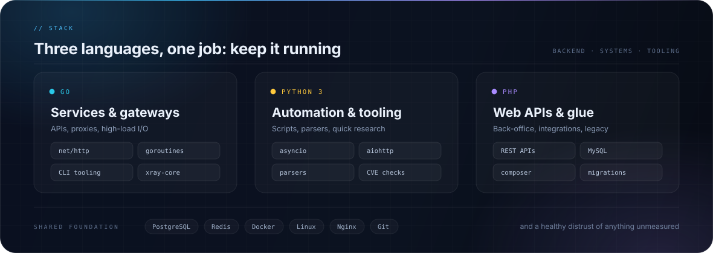

  

## Hey, I'm kitten443

> **Backend engineer.** I build the part of a product nobody notices until it breaks.

I write **Go** services, **Python 3** tooling and **PHP** web back ends. The work I like is the
unglamorous half of engineering: schema design, endpoints that stay idempotent under retries,
queues that do not duplicate work, deploys you can undo in one command, and logs that already
contain the answer.

- **Boring beats clever** — predictable code, predictable bills, predictable on-call.
- **Measure before you optimise** — no rewrite without a number that justifies it.
- **Rollback is a feature** — if I cannot go back, I am not done shipping.

## Stack

  

## The shape of a request

  

## Featured project — XLADA

  

**XLADA** is a proxy control plane I build and maintain: users, nodes, subscriptions and an
open, documented REST API on top of Xray-core. It started as a fork of Remnawave and grew into
its own thing — multi-node management, HWID device limits per user, subscription templates for
mihomo / sing-box / happ, admin audit log and data-retention rules, all shipped as four
repositories you can deploy with one compose file.

  
  
  
  

## Other public work

| Project | What it does | Stack |
| :-- | :-- | :-- |
| **[xclient](https://github.com/kitten443/xclient)** | Cross-platform desktop VPN client on Xray-core's native TUN inbound — Clean Architecture, MVVM, 1,270 tests green. | `C#` `.NET 8` |
| **[xpanel](https://github.com/kitten443/xpanel)** | Independent Xray-core management panel, forked from Remnawave and reworked: branding, log management, hardened privacy and security. | `TypeScript` |
| **[php2shell](https://github.com/kitten443/php2shell)** | Python 3 port of the official PHP2Shell checker — flags PHP versions exposed to CVE-2026-109618 / 109619. Reads versions, attacks nothing. | `Python 3` |
| **[Happ-Decryptor](https://github.com/kitten443/Happ-Decryptor)** | Go tool that pulls the real configuration out of Happ client profiles. | `Go` |
| **[link-parser](https://github.com/kitten443/link-parser)** | Go parser that turns a raw subscription link into a clean, structured list of outbounds. | `Go` |

## GitHub in numbers

  
  &nbsp;
  

Public numbers only — most backend work lives behind a login.

## Get in touch

  
  
  

  

Hand-written SVG, no template. Every pixel lives in <a href="assets"><code>assets/</code></a> — edit, recolour, ship.
